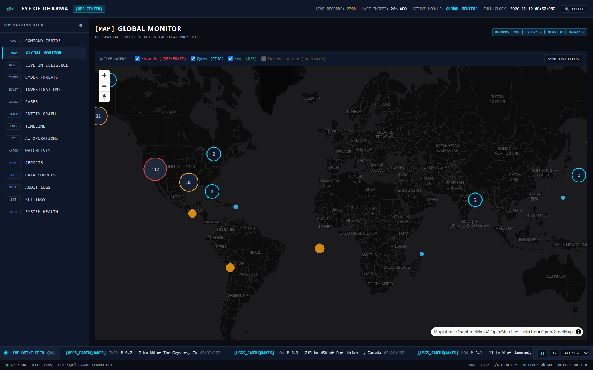
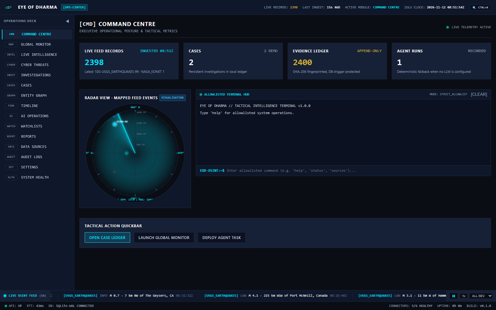
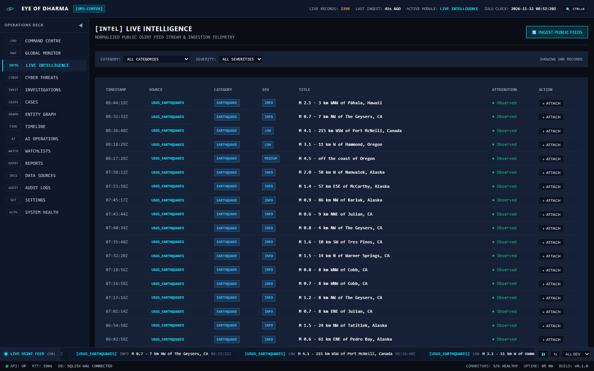
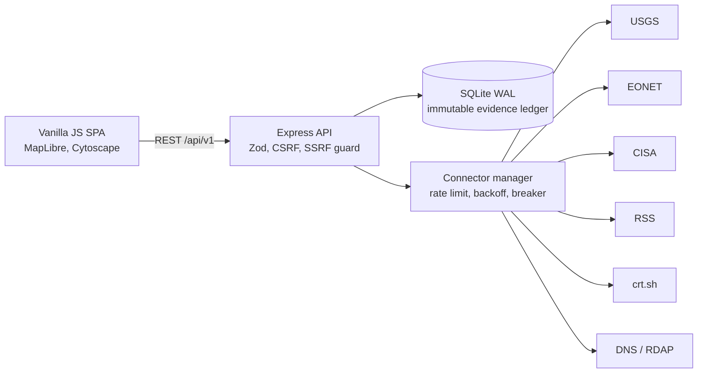

<p align="center"></p>

<h1 align="center">EYE OF DHARMA</h1>
<p align="center"><b>Observe. Correlate. Verify. Understand.</b><br/>Open-source intelligence &amp; digital investigation platform</p>

<p align="center">
  <a href="https://github.com/adiz777/eye-of-dharma/actions/workflows/ci.yml"></a>
  
  
</p>

> Independent, community-built project. Not affiliated with any government, military, intelligence or law-enforcement body. It works only with **public** data and is meant for defensive security and authorised research.



## What works today

| Area | Status |
|---|---|
| Live public feeds: **USGS earthquakes**, **NASA EONET**, **CISA KEV/advisories**, RSS/Atom | Working, polled in the background with rate limiting, retry/backoff and circuit breaker |
| Passive footprint lookups: **DNS (+DoH fallback)**, **RDAP**, **crt.sh** certificate transparency | Working via `POST /api/v1/investigate/footprint`; negative results are distinguished from errors |
| Global map (MapLibre + OpenFreeMap tiles) with clustered, source-linked event markers | Working |
| Cases, append-only notes, evidence ledger (SHA-256, DB-trigger immutability), entity/relationship graph | Working |
| Allowlisted terminal + `Ctrl+K` command palette | Working (no OS commands) |
| Agent run records (DHARMA / NETRA / CIPHER / SENTINEL / ATLAS / VERITAS / SCRIBE) | **Partial**: runs are recorded and audited; the LLM-backed orchestration and the deterministic report pipeline are not complete |
| HTML/PDF/CSV report export | **Planned** |
| Authentication / multi-user | **Planned** (bind to localhost only) |
| Aircraft, satellites, wildfires, AIS, NVD, URLhaus, ThreatFox, GDELT | **Planned** |

Synthetic demo cases are seeded on first boot and flagged `is_synthetic`; they are excluded from live feeds. The radar on the Command Centre only visualises ingested records; it is not a sensor.

## Screenshots
| Command Centre | Live Intelligence |
|---|---|
|  |  |

## Quick start
Requires Node.js 24+.

```bash
git clone https://github.com/adiz777/eye-of-dharma.git
cd eye-of-dharma
npm ci
npm start          # http://127.0.0.1:3000
```

Config is optional; see [`.env.example`](.env.example). Tests and type-check:

```bash
npx tsc --noEmit
npm test           # unit + integration (Vitest)
npm run test:e2e   # opaque-box tiers
```

## Architecture


## Data sources &amp; attribution
USGS Earthquake Hazards Program, NASA EONET, CISA, crt.sh, RDAP registries, public DNS-over-HTTPS, map data © OpenStreetMap contributors via OpenFreeMap / OpenMapTiles. Respect each provider's terms and rate limits.

## Security &amp; limitations
See [SECURITY.md](SECURITY.md). Key caveat: **there is no login yet**; do not expose this to the internet. The map and graph libraries load from a CDN (unpkg) and basemap tiles from OpenFreeMap, so the browser needs internet access for those.

## Roadmap
Auth + roles, report export, LLM provider abstraction (Ollama first) on top of the agent run model, more connectors (NVD, URLhaus, ThreatFox, GDELT), watchlist alerting, Cloudflare D1 deployment path.

## Contributing
Issues and PRs welcome. Run `npx tsc --noEmit && npm test` before opening a PR.

## License
[MIT](LICENSE)
